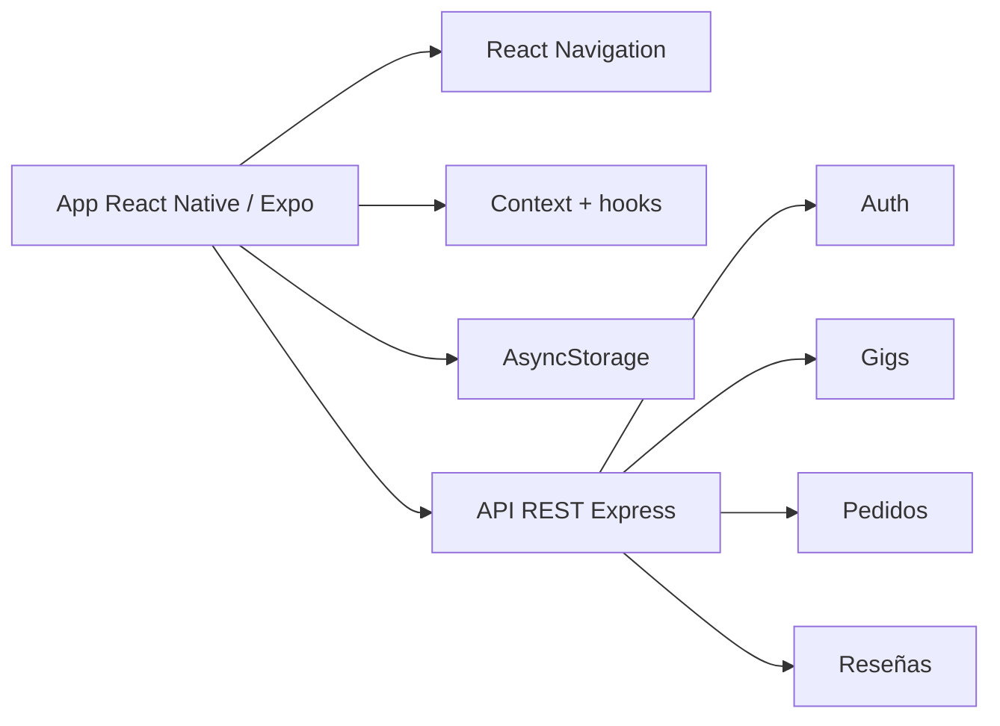

# AI Do It — Marketplace Mobile de Servicios


[English](README.md) | [Español](README.es.md)

> Proyecto individual de **Desarrollo de Software**, UTN FRBA, 2026.

## Descripción

AI Do It es una **app mobile** donde las personas pueden publicar y contratar servicios (gigs). Cubre el flujo completo: descubrimiento, detalle del servicio, pedidos, chat, reseñas y perfil, con roles demo para clientes y freelancers.

Está hecha con **React Native + Expo** y una **API REST en Express** para autenticación, gigs, pedidos, mensajes y reseñas.

## Features

- Autenticación y cambio de rol demo.
- Home con gigs destacados y en tendencia.
- Búsqueda y filtros por categoría.
- Detalle del gig con paquetes y reseñas.
- Creación de pedidos, seguimiento de estado y cancelación.
- Chat del pedido.
- Creación de reseñas.
- Perfil con acciones según rol.
- Persistencia local y configuración de API.

## Arquitectura



El frontend mobile sigue una estructura orientada a features:

- `frontend/src/screens` — pantallas.
- `frontend/src/hooks` — datos y efectos.
- `frontend/src/services` — clientes HTTP y adaptadores.
- `frontend/src/context` — estado global (auth, API config, rol demo).
- `frontend/src/domain` — reglas de negocio puras y validación de roles.
- `frontend/src/shared` — primitivas de diseño.
- `frontend/src/components` — componentes reutilizables.

El backend es una API Express con services, repositories, middleware, JWT y Swagger.

## Spec-driven development

El proyecto tiene **11 specs** en `specs/`, cubriendo onboarding, login por rol, búsqueda de gigs, paquetes, pedidos, chat, cancelación, reseñas y creación de pedidos.

## Mi rol

Construí el frontend mobile de punta a punta y lo integré con la API Express:

- Navegación y flujos de pantallas.
- Contexto de autenticación y roles demo.
- Fetching de datos, caché y estados de error.
- Persistencia con AsyncStorage.
- Flujos de pedidos y reseñas.
- Componentes reutilizables y un pequeño design system.

## Cómo ejecutarlo

Backend:

```bash
cd backend
cp .env.example .env
npm install
npm start
```

App mobile:

```bash
cd frontend
npm install
EXPO_PUBLIC_API_URL=http://localhost:3000 npx expo start
```

Para un dispositivo físico, configurá `EXPO_PUBLIC_API_URL` con la URL LAN de tu máquina.

## Stack

`React Native` · `Expo` · `React Navigation` · `AsyncStorage` · `JavaScript` · `Express` · `JWT` · `Swagger` · `Jest` · `Supertest` · `ESLint` · `Prettier`

## Notas

- No hay credenciales ni tokens locales en el repo.
- La app está pensada para mobile; Web está disponible con Expo para desarrollo.
- Código publicado con fines de portfolio.
