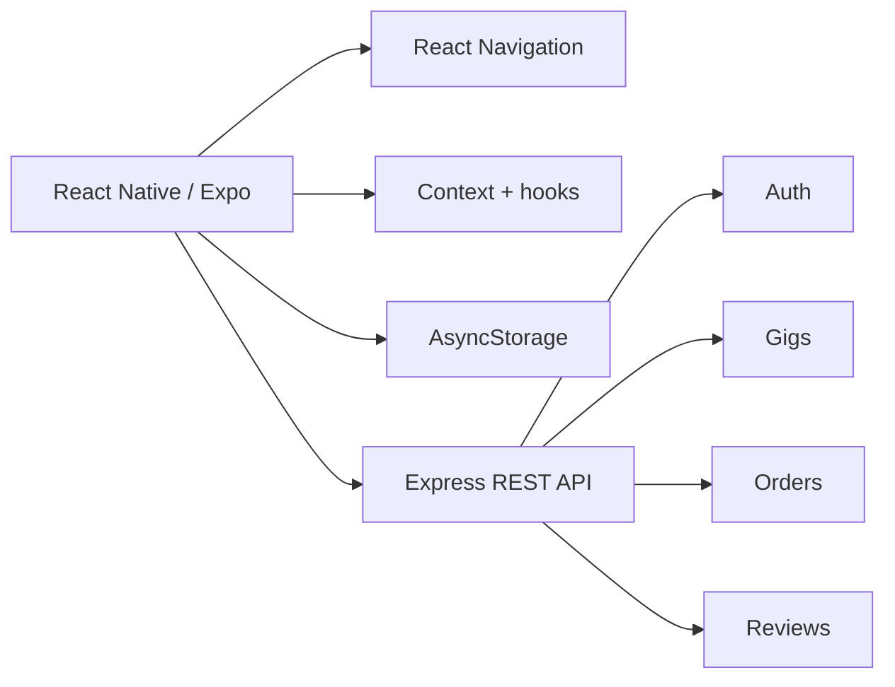

# AI Do It — Mobile Services Marketplace

> Individual project for **Desarrollo de Software**, UTN FRBA, 2026.
> The repository is private. This case study documents the product, architecture and my implementation.

## Overview

AI Do It is a mobile marketplace where people can **publish and hire services (gigs)**. The app covers the full flow: discovery, service details, orders, chat, reviews and profile management, with demo roles for clients and freelancers.

## Features

- Authentication and demo role switching.
- Home with featured and trending gigs.
- Search and category filters.
- Gig detail with packages and reviews.
- Order creation, status tracking and cancellation.
- Order chat.
- Review creation.
- Profile with role-aware actions.
- Local persistence and API configuration.

## Architecture

The frontend follows a feature-oriented structure:

- `screens/` — user-facing screens.
- `hooks/` — data and side-effect orchestration.
- `services/` — HTTP clients and adapters.
- `context/` — global state (auth, API config, demo role).
- `domain/` — pure business rules and role validation.
- `shared/` — design-system primitives.
- `components/` — reusable composed components.

## My role

I built the mobile frontend end-to-end and integrated it with the Express API:

- Navigation and screen flows.
- Authentication context and demo roles.
- Data fetching, caching and error states.
- AsyncStorage persistence.
- Order and review flows.
- Reusable UI components and a small design system.

## Stack

`React Native` · `Expo` · `React Navigation` · `AsyncStorage` · `JavaScript` · `Express` · `Jest` · `ESLint` · `Prettier`

## Links

- [LinkedIn](https://www.linkedin.com/in/luca-domio-dev)
- [Portfolio](https://github.com/lDomio)
- Code and demo available on request.
