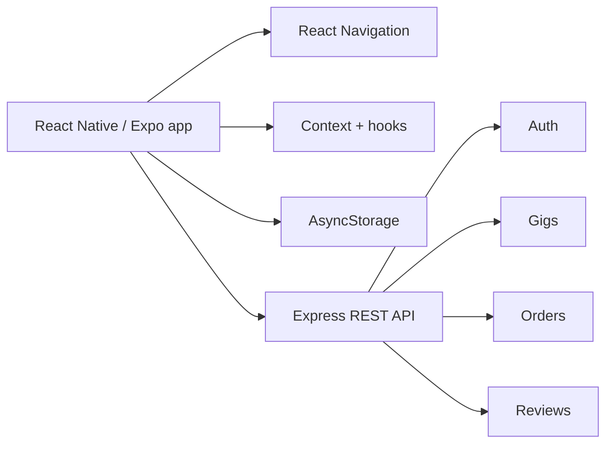

# AI Do It — Mobile Services Marketplace


[English](README.md) | [Español](README.es.md)

> Individual project for **Desarrollo de Software**, UTN FRBA, 2026.

## Overview

AI Do It is a **mobile app** where people can publish and hire services (gigs). It covers the full flow: discovery, service details, orders, chat, reviews and profile management, with demo roles for clients and freelancers.

Built with **React Native + Expo**, with an **Express REST API** for authentication, gigs, orders, messages and reviews.

## Features

- Authentication and demo role switching.
- Home with featured and trending gigs.
- Search and category filters.
- Gig detail with packages and reviews.
- Order creation, status tracking and cancellation.
- Order chat.
- Review creation.
- Profile with role-aware actions.
- Local persistence and API configuration.

## Architecture



The mobile frontend follows a feature-oriented structure:

- `frontend/src/screens` — user-facing screens.
- `frontend/src/hooks` — data and side-effect orchestration.
- `frontend/src/services` — HTTP clients and adapters.
- `frontend/src/context` — global state (auth, API config, demo role).
- `frontend/src/domain` — pure business rules and role validation.
- `frontend/src/shared` — design-system primitives.
- `frontend/src/components` — reusable composed components.

The backend is an Express API with services, repositories, middleware, JWT auth and Swagger documentation.

## Spec-driven development

The project contains **11 specs** under `specs/`, covering onboarding, role-based login, gig search, packages, orders, chat, cancellation, reviews and order placement.

## My role

I built the mobile frontend end-to-end and integrated it with the Express API:

- Navigation and screen flows.
- Authentication context and demo roles.
- Data fetching, caching and error states.
- AsyncStorage persistence.
- Order and review flows.
- Reusable UI components and a small design system.

## Running locally

Backend:

```bash
cd backend
cp .env.example .env
npm install
npm start
```

Mobile app:

```bash
cd frontend
npm install
EXPO_PUBLIC_API_URL=http://localhost:3000 npx expo start
```

For a physical device, set `EXPO_PUBLIC_API_URL` to your machine's LAN URL.

## Stack

`React Native` · `Expo` · `React Navigation` · `AsyncStorage` · `JavaScript` · `Express` · `JWT` · `Swagger` · `Jest` · `Supertest` · `ESLint` · `Prettier`

## Notes

- No credentials or local tokens are committed.
- The app is designed for mobile; Web is available through Expo for development.
- Code published for portfolio purposes.
